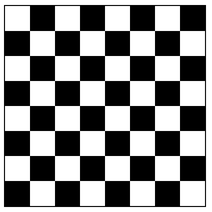

# Tripledollar


> [!NOTE]
> **New in v2.0** — Tripledollar v2.0 is a direct, modernized replacement for v1.x, keeping the familiar API with only a few intentional breaking changes (see [Migrating from v1 to v2](#migrating-from-v1-to-v2)).
>
> **Key improvements in v2.0:**
> - **Modern ES Modules & zero runtime dependencies** (ships both ESM and a ~5 KB minified CDN `<script>` bundle)
> - **First-class TypeScript declarations** generated directly from the source (`dist/index.d.ts`)
> - **Faster & cleaner DOM helpers**: hoisted, non-enumerable `.evt()`, `.css()`, `.ins()`, `.set()`, `.fun()` with idempotent `$$$(el)` wrapping
> - **Modern Web Platform support**: native `Promise` in `appendToDoc()`, `AddEventListenerOptions` (`{ once, passive, signal }`) in `evt()`, CSS custom properties (`--var`) in `css()`, and `replaceChildren()` in `destroy()`
> - **Better ergonomics & fixes**: proper boolean attributes, skipped falsy children, class merging, kebab-case `data-*`, accurate SVG/namespace round-tripping in `structify()`/`parse()`/`stringify()`, and SSR/Node safety via `createTripledollar(window)`
> - **Dedicated CLI**: the old built-in `td` command has moved to a separate package, **[tripledollar-cli](https://github.com/steenk/td-cli)**

Website: [tripledollar.net](https://tripledollar.net)

When you create a lot of DOM elements from JavaScript and want a minimalistic approach, **tripledollar** is it. It is not a framework—it is a tiny (~5 KB minified), zero-dependency helper library for creating and manipulating DOM elements cleanly in modern JavaScript and TypeScript.

Compare building this markup with plain DOM calls:

```html
<div id="d001" class="simple" style="display:inline; background-color:blue;">
  <strong class="bold">Tripledollar</strong>
  <button name="but001">OK</button>
</div>
```

With **tripledollar**:

```javascript
import $$$ from 'tripledollar';

const div = $$$(
  'div.simple#d001',
  $$$('strong.bold', 'Tripledollar'),
  $$$('button', { name: 'but001' }, 'OK').evt('click', () => alert('hello'))
).css({ display: 'inline', backgroundColor: 'blue' });

await $$$.appendToDoc(div);
```

---

## Installation

### npm / Bundlers (Rollup, Vite, Webpack, Node.js)

```sh
npm install tripledollar
```

```javascript
import $$$, { appendToDoc, destroy, namespace, parse, stringify, structify } from 'tripledollar';
```

### Project Scaffolding & Dev Server (`tripledollar-cli`)

The old built-in `td` CLI has been replaced by a separate, zero-dependency companion package, **[tripledollar-cli](https://github.com/steenk/td-cli)**, which provides the `td` command for scaffolding Rollup + Tripledollar v2 projects and running a lightweight built-in HTTP dev server:

```sh
npm install -g tripledollar-cli
mkdir my-app && cd my-app
td --init --name "My App"
npm install
npm run build
npm run start
```

### Direct Browser / CDN Usage

As an ES module:

```html
<script type="module">
  import $$$ from 'https://cdn.jsdelivr.net/npm/tripledollar@2/dist/tripledollar.js';

  $$$.appendToDoc(['h1', 'Hello Tripledollar!']);
</script>
```

Or as a classic global `<script>` (exposes `window.$$$`):

```html
<script src="https://cdn.jsdelivr.net/npm/tripledollar@2/dist/tripledollar.min.js"></script>
<script>
  $$$.appendToDoc(['div', { style: { color: 'hotpink', fontSize: '4rem' } }, "Don't write HTML!"]);
</script>
```

### Node.js / SSR / Custom DOM (jsdom, happy-dom)

Importing `tripledollar` does not access `window` or `document` at load time, so it is safe in SSR and Node.js. To bind an isolated instance to a specific DOM window:

```javascript
import { JSDOM } from 'jsdom';
import { createTripledollar } from 'tripledollar';

const { window } = new JSDOM('<!doctype html><html><body></body></html>');
const $$$ = createTripledollar(window);

await $$$.appendToDoc(['div', ['h2', 'Tripledollar']]);
console.log(window.document.body.innerHTML);
```

### TypeScript

Type declarations are bundled automatically (`dist/index.d.ts`), including `TDElement`, `TDStruct`, `StyleMap`, `AttrMap`, and `Tripledollar`:

```typescript
import $$$, { type TDElement, type TDStruct } from 'tripledollar';

const card: TDStruct = ['section.card', ['h2', 'Title']];
const el: TDElement | undefined = $$$(card);
```

---

## Creating DOM Elements

The first argument to `$$$` is the **identity** string: tag name (or `prefix:tagName` for namespaces), followed by `.className` and `#id` in any order:

```javascript
const h1 = $$$('h1.large.blueish#h0001', 'Heading');
const widget = $$$('my-widget.active');
```

Remaining arguments can appear in any order:

- **Attributes object**: sets HTML/SVG/namespaced attributes.
  - Boolean `true` produces a valueless attribute (`{ disabled: true }` → `disabled`); `false`, `null`, and `undefined` are omitted.
  - `class` merges with classes from the identity string (`$$$('div.a', { class: 'b c' })` → `class="a b c"`).
  - `style` accepts either a CSS string or a style object (including CSS custom properties like `'--accent': '#fc0'`).
  - Camel-cased `data*` keys become kebab-case `data-*` attributes (`{ dataUserId: '42' }` → `data-user-id="42"`).
- **DOM nodes** (`Element`, `Text`, `DocumentFragment`) or **nested `tdstruct` arrays** (`['p', 'Hello']`).
- **Arrays of children** (e.g., `items.map(item => ['li', item])`).
- **Text / numbers** (`0` renders `"0"`; `null`, `undefined`, booleans, and `''` are skipped—making conditional expressions like `isAdmin && ['span', 'Admin']` work cleanly).

Wrapping an existing DOM element attaches the helper methods idempotently without double-processing:

```javascript
const button = document.querySelector('button');
$$$(button).evt('click', handleClick, { once: true });
```

---

## Element Helper Methods

Every element created or wrapped by `$$$` exposes five chainable, non-enumerable helper methods:

### `el.css(styles)`

Applies camelCase properties, kebab-case properties, CSS custom properties (`--var`), removals (`null`/`undefined`), and recursive nested CSS selector rules:

```javascript
const chess = $$$('div');
for (let r = 0; r < 8; r++) {
  const row = $$$('div.row');
  chess.ins(row);
  for (let c = 0; c < 8; c++) {
    row.ins($$$('div.cell.' + ((r + c) % 2 === 0 ? 'white' : 'black')));
  }
}

chess.css({
  width: '200px',
  height: '200px',
  border: 'solid black 1px',
  '--cell-size': '25px',
  '.row': { height: 'var(--cell-size)' },
  '.cell': {
    display: 'inline-block',
    margin: 0,
    width: 'var(--cell-size)',
    height: 'var(--cell-size)'
  },
  '.black': { backgroundColor: 'black' }
});

await $$$.appendToDoc(chess);
```



### `el.evt(type, listener, options?)`

Standard wrapper around `addEventListener(type, listener, options)`—supports `{ once, passive, capture, signal }` (including `AbortController`):

```javascript
const controller = new AbortController();
const btn = $$$('button', 'Click me').evt(
  'click',
  (event) => console.log(event.target),
  { once: true, signal: controller.signal }
);
```

### `el.ins(...items)`

Inserts additional elements, `tdstruct` arrays, child lists, attributes, or text into an existing element:

```javascript
const div = $$$('div#d002')
  .ins(['label', 'Status: '], ['span', 'Ready'])
  .ins([$$$('div', 'One'), ['div', 'Two']]);
```

### `el.set(key, value)` & `el.fun(name, ...args)`

Sets JavaScript properties or invokes methods inside a chain:

```javascript
const el = $$$('h2', 'tripledollar')
  .set('dash', function (delim) {
    this.textContent = this.textContent.split('').join(delim);
  })
  .fun('dash', '-')
  .css({ color: 'red' });
```

---

## TDStruct, `structify`, `stringify`, and `parse`

A **tdstruct** is a plain JSON-serializable nested array representation of a DOM tree:

```javascript
const tdstruct = [
  'table#t1',
  { border: 1 },
  ['tbody', ['tr', ['td', 'one'], ['td', 'two'], ['td', 'three']]]
];

const table = $$$(tdstruct);
```

Convert back and forth between live DOM elements, `tdstruct` arrays, and JSON strings:

```javascript
const struct = $$$.structify(table, { trim: true });
const json = $$$.stringify(table);
const rebuilt = $$$.parse(json); // returns an enhanced DOM Element
```

Both `parse` and `stringify` preserve SVG/custom namespaces and throw standard `TypeError` / `SyntaxError` exceptions on invalid input.

---

## `appendToDoc`, `onReady`, `destroy`, and `namespace`

- **`$$$.appendToDoc(...items)`**: Waits for `DOMContentLoaded` if needed, appends elements / `tdstruct` arrays to `document.body` (and invokes any callback arguments), and returns a native `Promise<Node[]>` resolving to the appended nodes.
- **`$$$.onReady(callback)`**: Runs `callback` on `DOMContentLoaded`, or via `queueMicrotask` if the document is already ready.
- **`$$$.destroy(el, removeSelf = false)`**: Clears all child nodes via `replaceChildren()`, and removes `el` itself when `removeSelf` is `true`.
- **`$$$.namespace(name, uri?)`**: Gets or registers an XML namespace URI (`svg`, `xlink`, and `xhtml` are built in).

```javascript
$$$.namespace('td', 'https://tripledollar.net');
const box = $$$('td:box.td-box');
```

### SVG Example

```javascript
const svg = $$$(
  'svg',
  { width: 300, height: 250 },
  [
    'svg:a',
    { 'xlink:href': 'https://tripledollar.net' },
    [
      'svg:text',
      { x: 110, y: 120, 'font-size': 60, fill: 'gold', stroke: 'black', 'stroke-width': 1 },
      '$$$'
    ]
  ]
);

await $$$.appendToDoc(['h1', 'SVG Lab'], svg);
```

---

## Migrating from v1 to v2

| v1 | v2 |
| :--- | :--- |
| `$$$.query(sel)` / `el.query(sel)` | Use native `document.querySelector(sel)` / `el.querySelector(sel)` (wrap with `$$$(el)` if you need helper methods) |
| `$$$.queryAll(sel)` / `el.queryAll(sel)` | Use native `document.querySelectorAll(sel)` / `el.querySelectorAll(sel)` |
| `$$$.setImmediate(fn)` | Use native `queueMicrotask(fn)` or `setTimeout(fn, 0)` |
| `el.evt('click', fn, arg1, arg2)` | Use arrow functions: `el.evt('click', e => fn(e, arg1, arg2), options)` |
| `$$$.parse(json)` returned a `tdstruct` array | Now returns a DOM `Element` (use `JSON.parse(json)` if you want the raw array) |
| `parse` / `stringify` warned and returned `undefined` | Now throw `TypeError` / `SyntaxError` on invalid input |
| `require('tripledollar')(window)` | ESM `import { createTripledollar } from 'tripledollar'; const $$$ = createTripledollar(window);` |
| `td` CLI (`td --init`, `td --start`) | Replaced by the separate **[tripledollar-cli](https://github.com/steenk/td-cli)** package so `tripledollar` has zero runtime dependencies |
| AMD / RequireJS / Bower | Removed; use ESM or `dist/tripledollar.min.js` |

---

## Development

```sh
npm install
npm run typecheck   # tsc --noEmit (checks src/*.js via JSDoc)
npm run build       # builds dist/tripledollar.js, dist/tripledollar.min.js, and dist/*.d.ts
npm test            # runs Vitest suite
```
